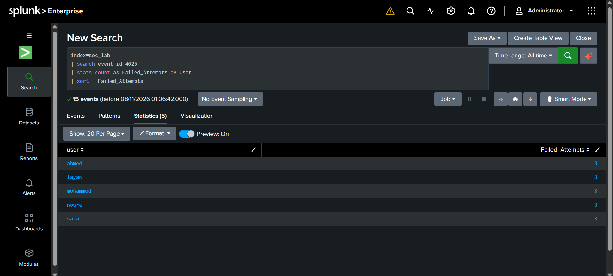

# Windows Authentication Security Incident Investigation Report

## 1. Incident Overview

       | Field | Details |
| Incident Name | Potential Password Spraying Activity |
| Environment | Simulated Windows Authentication Lab |
| SIEM Tool | Splunk Enterprise |
| Source IP | 203.0.113.50 |
| Affected Accounts | 5 |
| Event IDs | 4624, 4625, 4740 |
| Investigation Status | Completed – Lab Simulation |

## 2. Executive Summary

During the investigation, Windows authentication events were analyzed using Splunk Enterprise to identify suspicious login patterns.

The analysis identified 15 failed login attempts originating from the same source IP address and targeting five different user accounts. A successful login to the account `ahmed` was also recorded from the same IP address.

Additionally, two account lockout events were identified.

The observed activity is consistent with a potential Password Spraying pattern. However, since this investigation uses synthetic data, it does not represent a confirmed real-world security incident.

## 3. Failed Login Analysis

Windows Event ID 4625 represents failed login attempts.

The investigation identified:
- 15 failed login attempts.
- 5 targeted user accounts.
- 3 failed attempts per account.

These results indicate repeated authentication failures across multiple accounts from the same source IP.

## 4. Source IP Investigation

The source IP analysis identified `203.0.113.50` as the origin of all 15 failed login attempts.

The IP targeted five different user accounts, making the activity consistent with a potential Password Spraying pattern.

**[INSERT IMAGE HERE]**

Image filename: `Failed_Login_Attempts_By_Source_IP.png`

## 5. Successful Login Investigation

Further investigation identified a successful login event (Event ID 4624) from the same source IP address.

The successful authentication was associated with the account `ahmed`.

This finding is important because a successful login occurred after the failed authentication activity. In a real environment, this would require additional investigation to determine whether the login was legitimate or potentially unauthorized.

**[INSERT IMAGE HERE]**

Image filename: `Successful_Login_From_Suspicious_IP.png`

## 6. Account Lockout Analysis

Windows Event ID 4740 represents an account lockout event.

The investigation identified two locked accounts:
- sara
- noura

These events indicate that the authentication failures resulted in account lockouts within the simulated environment.

**[INSERT IMAGE HERE]**

Image filename: `Locked_Accounts.png`

## 7. Detection Logic and Alert Configuration

A detection search was developed in Splunk to identify source IP addresses generating:

- At least 10 failed login attempts.
- Failed attempts targeting at least 5 distinct user accounts.

An alert named **Multiple Failed Login Attempts** was configured to run on a scheduled basis.

The thresholds were selected for this training dataset and should be adjusted according to the organization's environment and security requirements.

**[INSERT IMAGE HERE]**

Image filename: `Splunk_Detection_Alert.png`

## 8. Security Monitoring Dashboard

A Splunk dashboard was created to provide an overview of Windows authentication activity.

The dashboard includes:
- Total login attempts.
- Failed login attempts.
- Successful logins.
- Locked accounts.
- Targeted user accounts.
- Login activity over time.
- Failed login attempts by source IP and user.

**[INSERT IMAGE HERE]**

Image filename: `Windows Authentication Security Monitoring.png`

## 9. Recommended Response Actions

If similar activity were detected in a real organizational environment, the recommended actions would include:

1. Investigate the source IP address and verify whether it belongs to a legitimate user or system.
2. Review successful authentication events associated with the affected accounts.
3. Validate the legitimacy of the successful login to the `ahmed` account.
4. Review account lockout events and investigate the affected accounts.
5. Reset affected account passwords if unauthorized access is suspected.
6. Continue monitoring authentication events for further suspicious activity.

## 10. Conclusion

This project demonstrates a practical SOC investigation workflow using Splunk Enterprise.

Through Windows authentication log analysis, the investigation identified repeated failed login attempts, multiple targeted accounts, a subsequent successful login, and account lockout events.

The project also demonstrates how SPL searches, scheduled alerts, and dashboards can support security monitoring and threat detection.

**Disclaimer:** This project was developed for educational and portfolio purposes using synthetic authentication data. The source IP `203.0.113.50` belongs to a reserved documentation range and does not represent a real attacker.
